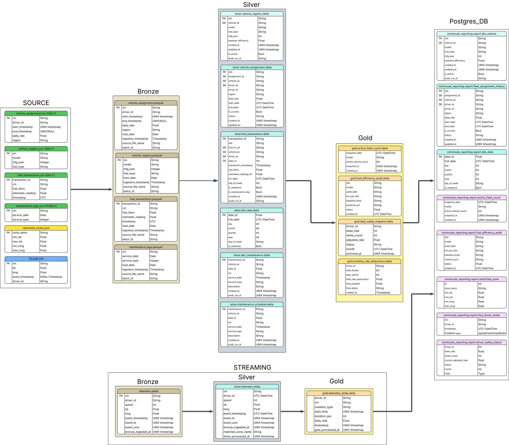

# 🚚 OmniRoute — Smart Logistics Data Engine

> An enterprise-grade Data Warehouse solution that ingests, processes, and analyzes high-velocity telemetry data from a global fleet of delivery vehicles using a **Medallion Architecture** on AWS.

---

## Overview

OmniRoute is a data platform that combines **batch ETL** and **real-time streaming** to deliver a comprehensive view of asset health, driver behavior, and operational efficiency for fleet logistics. The system is built on **AWS** (S3, Glue, EMR, Kafka, PostgreSQL) and orchestrated by **Apache Airflow**.

### Business Objectives

| Pillar | Description |
|---|---|
| **Asset Lifecycle Management** | Historical records of vehicle and driver transitions using SCD Type 2 logic |
| **Operational Efficiency** | Fuel consumption auditing — flags vehicles exceeding fleet baseline by >12% |
| **Safety Compliance** | Real-time monitoring of speeding (>110 km/h) and geofence violations |
| **Financial Accountability** | Automated 5% per-strike deductions from driver rates with monthly cooldown resets |

---

## Architecture



```
                        ┌──────────────┐
                        │  Kafka Topic │  (vehicle telemetry — speed, RPM, GPS)
                        └──────┬───────┘
                               │
  CSV/JSON files on S3         │ Real-time stream
  (vehicle_registry,           │
   vehicle_assignment,         │
   fuel_transactions,          ▼
   maintenance_schedules) ──► ┌──────────────────────────────────────────────┐
                              │            AWS EMR Cluster                   │
                              │  ┌──────────┐ ┌──────────┐ ┌──────────┐     │
                              │  │  Bronze   │ │  Silver  │ │   Gold   │     │
                              │  │ Streaming │ │ Streaming│ │ Streaming│     │
                              │  └──────────┘ └──────────┘ └──────────┘     │
                              └──────────────────────────────────────────────┘
                                               │
  ┌────────────────────────────────────────────┼──────────────────────────┐
  │                   AWS Glue (Batch ETL)     │                         │
  │  ┌─────────┐   ┌──────────┐   ┌────────┐  │  ┌───────────────────┐  │
  │  │ Bronze  │──►│  Silver  │──►│  Gold  │──┼─►│   PostgreSQL      │  │
  │  │ Ingest  │   │Transform │   │Aggreg. │  │  │   (Reporting)     │  │
  │  └─────────┘   └──────────┘   └────────┘  │  └───────────────────┘  │
  └────────────────────────────────────────────┴──────────────────────────┘
                               │
                               ▼
                    ┌───────────────────┐
                    │   Apache Airflow  │  (Orchestration — 3 DAGs)
                    └───────────────────┘
```

### Key Technologies

| Component | Technology |
|---|---|
| **Storage** | Amazon S3 (Data Lake — Bronze / Silver / Gold) |
| **Batch Compute** | AWS Glue 4.0 (PySpark + Delta Lake) |
| **Stream Compute** | Apache Spark Structured Streaming on EMR 7.12.0 |
| **Message Broker** | Apache Kafka |
| **Orchestration** | Apache Airflow 3.2 |
| **Reporting DB** | PostgreSQL |
| **Table Format** | Delta Lake |

---

## Data Sources

| Source | Format | Frequency | Description |
|---|---|---|---|
| Vehicle Registry | CSV | Daily | Master list — VINs, models, manufacturing years |
| Vehicle Assignment | CSV | Daily (incremental) | Driver ↔ Vehicle mapping with `daily_rate` |
| Maintenance Schedules | CSV | Yearly (Jan 1st) | Scheduled downtime and service dates |
| Fuel Transactions | CSV | Daily | Fuel quantity, cost, odometer readings |
| Telemetry Stream | JSON (Kafka) | Real-time | Speed, RPM, GPS coordinates |
| Restricted Zones | JSON / PostgreSQL | Static / ad-hoc | No-go GPS bounding boxes |

---

## Pipelines

Three Airflow DAGs orchestrate the entire platform:

| DAG | Schedule | Purpose |
|---|---|---|
| `omniroute_midnight_pipeline` | Daily 00:00 UTC | Yearly bootstrap + daily core ETL + monthly reporting |
| `omniroute_morning_fuel_pipeline` | Daily 05:00 UTC | Fuel Bronze → Silver → Gold → PostgreSQL |
| `omniroute_emr_streaming_pipeline` | Manual trigger | Real-time Kafka → Bronze → Silver → Gold on EMR |

For dependency graphs, task breakdowns, and gating logic, see **[Pipeline Documentation](docs/pipelines_md.md)**.

---

## Spark / Glue Jobs

### Batch Jobs (13 Glue scripts)

Located in `spark_jobs/batch/` — executed by AWS Glue via Airflow.

| Job | Layer |
|---|---|
| `daily_ingest_bronze_glue.py` | Bronze — CSV → Parquet with quarantine |
| `yearly_ingest_maintenance_schedules_glue.py` | Bronze — Annual maintenance ingestion |
| `transform_vehicle_registry_glue.py` | Silver — SCD1 + soft-delete |
| `transform_vehicle_assignment_glue.py` | Silver — SCD2 (two-pass MERGE) |
| `transform_fuel_transactions_glue.py` | Silver — Insert-only MERGE |
| `transform_maintenance_schedules_glue.py` | Silver — SCD1 with fraud validation |
| `transform_dim_date_glue.py` | Silver — Date dimension (yearly) |
| `gold_fuel_efficiency_audit_glue.py` | Gold — Flags >12% above baseline |
| `gold_active_fleet_snapshot_glue.py` | Gold — IN-TRANSIT count by model |
| `daily_safety_snapshot_glue.py` | Gold — PG → S3 safety archive |
| `monthly_rate_deduction_report_glue.py` | Gold — Payroll deduction report |
| `monthly_safety_strikes_reset_glue.py` | Gold — Monthly strikes reset |
| `gold_to_postgres_glue.py` | Gold → PG — Syncs 5 tables |

For MERGE strategies, idempotency patterns, and quarantine logic, see **[Batch Architecture](docs/batch_architecture.md)**.

### Streaming Jobs (3 EMR scripts)

Located in `spark_jobs/streaming/` — executed on EMR via Airflow.

| Job | Layer | Description |
|---|---|---|
| `bronze_streaming.py` | Bronze | Kafka → S3 Delta (raw telemetry) |
| `silver_streaming.py` | Silver | Enrichment, geofence matching, DLQ |
| `gold_streaming.py` | Gold | Stateful strike detection via `applyInPandasWithState` |

For streaming internals (schemas, state management, fault tolerance), see **[Streaming Architecture](docs/streaming_architecture.md)**.

---

## Reporting Layer — PostgreSQL

The `report` schema in PostgreSQL serves as the downstream reporting sink. Full DDL is in [`sql/reporting_ddl.sql`](sql/reporting_ddl.sql).

| Table | Source |
|---|---|
| `report.fleet_assignment_history` | Silver — SCD2 assignment history |
| `report.fuel_efficiency_audit` | Gold — Audit results with variance % |
| `report.active_fleet_snapshot` | Gold — Daily IN-TRANSIT count by model |
| `report.dim_vehicle` | Silver — Vehicle master dimension |
| `report.dim_date` | Silver — Calendar dimension |
| `report.driver_safety_status` | Gold — Live strike count + adjusted rate |
| `report.fact_driver_strike` | Gold — Strike event log |
| `restricted_zones` | Static — GPS bounding boxes |

---

## Project Structure

```
omniroute/
├── config/
│   ├── s3_paths.json                 # S3 paths + Glue job configuration
│   ├── airflow_variables.json        # Airflow Variables (PG creds, EMR subnet, etc.)
│   └── airflow_connections.json      # Airflow Connections (aws_default)
│
├── dags/
│   ├── omniroute_midnight_pipeline_dag.py
│   ├── omniroute_morning_fuel_pipeline_dag.py
│   └── EMR_DAG.py
│
├── spark_jobs/
│   ├── batch/                        # 13 AWS Glue PySpark scripts
│   └── streaming/                    # 3 EMR Spark Structured Streaming scripts
│       ├── bootstrap_omniroute.sh    # EMR bootstrap action
│       └── emr_package.sh           # Packages shared libs for --py-files
│
├── scripts/
│   ├── config.py                     # Shared configuration loader
│   └── producers/                    # Kafka data producers (simulation)
│
├── sql/
│   └── reporting_ddl.sql             # PostgreSQL DDL
│
├── docs/
│   ├── streaming_architecture.md     # Streaming architecture deep-dive
│   ├── batch_architecture.md         # Batch architecture deep-dive
│   ├── pipelines_md.md               # DAG dependency graphs & task breakdowns
│   ├── operations.md                 # Runbook, troubleshooting, configuration
│   └── assets/                       # SVG/PNG diagrams
│
├── tests/
│   └── test_streaming.py
│
├── requirements.txt
└── .gitignore
```

---

## Documentation

| Document | Contents |
|---|---|
| **[Streaming Architecture](docs/streaming_architecture.md)** | Bronze/Silver/Gold streaming internals, schemas, state management, fault tolerance |
| **[Batch Architecture](docs/batch_architecture.md)** | Glue job catalog, MERGE strategies, idempotency, quarantine, S3 layout |
| **[Pipeline Documentation](docs/pipelines_md.md)** | DAG dependency graphs, task tables, gating logic, EMR cluster config |
| **[Operations Guide](docs/operations.md)** | Airflow variables/connections, runbook, troubleshooting playbook |

---

## Getting Started

### Prerequisites

- **AWS Account** with access to S3, Glue, EMR, and IAM
- **Apache Airflow 3.2+** with the `amazon` provider package
- **Apache Kafka** cluster (for telemetry streaming)
- **PostgreSQL** instance (for the reporting layer)
- **Python 3.10+**

### Quick Start

```bash
# 1. Clone
git clone <repo-url>
cd omniroute

# 2. Install dependencies
pip install -r requirements.txt

# 3. Set up PostgreSQL
psql -h <host> -U omniroute_user -d omniroute_reporting -f sql/reporting_ddl.sql

# 4. Configure Airflow
airflow variables import config/airflow_variables.json
airflow connections import config/airflow_connections.json

# 5. Deploy Glue scripts to S3
# Upload each script in spark_jobs/batch/ to its s3_paths.json script_location

# 6. Deploy streaming scripts
cd spark_jobs/streaming
bash emr_package.sh
aws s3 cp bronze_streaming.py s3://<bucket>/emr/
aws s3 cp silver_streaming.py s3://<bucket>/emr/
aws s3 cp gold_streaming.py   s3://<bucket>/emr/
aws s3 cp bootstrap_omniroute.sh s3://<bucket>/emr/

# 7. Enable DAGs in Airflow UI
```

For detailed setup, troubleshooting, and operational procedures, see **[Operations Guide](docs/operations.md)**.

---

## License

Internal project — not for public distribution.
