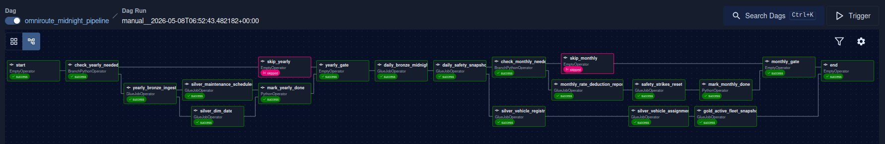
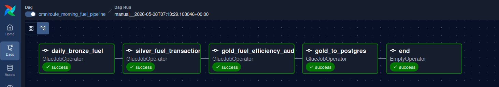

# OmniRoute Batch Architecture

> Two Airflow-orchestrated pipelines running **13 AWS Glue jobs** across daily, monthly, and yearly cadences — ingesting CSVs through a **Medallion Architecture** (Bronze → Silver → Gold), persisting as **Delta Lake** on S3, and syncing reporting tables to **PostgreSQL**.

---

## Table of Contents

- [High-Level Overview](#high-level-overview)
- [Runtime Environment](#runtime-environment)
- [DAG 1 — Midnight Pipeline](#dag-1--midnight-pipeline)
  - [Yearly Branch](#yearly-branch)
  - [Daily Core](#daily-core)
  - [Monthly Branch](#monthly-branch)
- [DAG 2 — Morning Fuel Pipeline](#dag-2--morning-fuel-pipeline)
- [Glue Job Catalog](#glue-job-catalog)
- [Data Flow Summary](#data-flow-summary)
- [MERGE Strategies & Idempotency](#merge-strategies--idempotency)
- [Variable-Based Gating](#variable-based-gating)
- [Quarantine & Error Handling](#quarantine--error-handling)
- [Configuration Reference](#configuration-reference)

---

## High-Level Overview

```
S3 Landing (CSV)
  │
  ▼
Bronze Ingestion ──▶ S3 Bronze (Parquet)
  │                     │
  │                     ▼
  │               Silver Transforms ──▶ S3 Silver (Delta Lake)
  │                     │                    │
  │                     ▼                    ▼
  │               Gold Aggregations ──▶ S3 Gold (Delta Lake)
  │                                          │
  │                                          ▼
  │                                     PostgreSQL
  │                                    (report.*)
  ▼
S3 Quarantine (rejected rows)
S3 Archive (processed CSVs)
```

The batch pipeline operates via two coordinated Airflow DAGs:

| DAG                               | Schedule      | Purpose                                           |
| --------------------------------- | ------------- | ------------------------------------------------- |
| `omniroute_midnight_pipeline`     | Daily 00:00 UTC | Yearly bootstrap + daily core + monthly jobs      |
| `omniroute_morning_fuel_pipeline` | Daily 05:00 UTC | Fuel-specific Bronze → Silver → Gold → PostgreSQL |

The morning DAG depends on the midnight DAG via `ExternalTaskSensor` (currently commented out but architecturally expected).

---

## Runtime Environment

| Property          | Value                                            |
| ----------------- | ------------------------------------------------ |
| Orchestrator      | Apache Airflow 3.x (MWAA)                       |
| Compute           | AWS Glue ETL (Spark, PySpark)                    |
| Glue Version      | 4.0                                              |
| Storage Format    | Bronze: Parquet, Silver/Gold: Delta Lake         |
| Storage           | Amazon S3                                        |
| Database          | PostgreSQL (EC2, `report.*` schema)              |
| Region            | `us-east-1`                                      |
| Config Source      | `s3_paths.json` (loaded at DAG parse time)       |

---

## DAG 1 — Midnight Pipeline

**DAG ID:** `omniroute_midnight_pipeline`
**Schedule:** `0 0 * * *` (daily at 00:00 UTC)
**Max Active Runs:** 1



The midnight pipeline is a unified DAG that handles yearly, daily, and monthly workloads through **Variable-based branching**. It uses `BranchPythonOperator` to conditionally skip yearly and monthly sections once they've succeeded for the current period.

### Yearly Branch

Runs once per year (with automatic retry on subsequent days if Jan 1st fails). Controlled by Airflow Variable `omniroute_yearly_done_YYYY`.

| Task                         | Glue Job Script                                  | ER Table          | Description                                                        |
| ---------------------------- | ------------------------------------------------ | ----------------- | ------------------------------------------------------------------ |
| `check_yearly_needed`        | *(BranchPythonOperator)*                         | —                 | Checks Variable; branches to `yearly_bronze_ingest` or `skip_yearly` |
| `yearly_bronze_ingest`       | `yearly_ingest_maintenance_schedules_glue.py`    | —                 | Reads `maintenance_schedules.csv` from S3 landing → Parquet        |
| `silver_maintenance_schedules` | `transform_maintenance_schedules_glue.py`      | `dim_maintenance` | SCD1 MERGE; validates `service_type` against whitelist             |
| `silver_dim_date`            | `transform_dim_date_glue.py`                     | `dim_date`        | Generates 365/366 date rows for the year; insert-only MERGE        |
| `mark_yearly_done`           | *(PythonOperator)*                               | —                 | Sets `omniroute_yearly_done_YYYY = true`                           |
| `skip_yearly`                | *(EmptyOperator)*                                | —                 | No-op when yearly tasks already completed                          |
| `yearly_gate`                | *(EmptyOperator, `none_failed_min_one_success`)* | —                 | Convergence point; daily tasks wait here                           |

**Dependency chain:**
```
start → check_yearly_needed ─┬─▶ yearly_bronze_ingest → [silver_maintenance, silver_dim_date] → mark_yearly_done ──┐
                              └─▶ skip_yearly ──────────────────────────────────────────────────────────────────────┤
                                                                                                                    ▼
                                                                                                              yearly_gate
```

### Daily Core

Runs every day after the yearly gate passes. This is the pipeline's critical path.

| Task                     | Glue Job Script                             | ER Table                           | Description                                                                 |
| ------------------------ | ------------------------------------------- | ---------------------------------- | --------------------------------------------------------------------------- |
| `daily_bronze_midnight`  | `daily_ingest_bronze_glue.py`               | —                                  | Ingests `vehicle_registry.csv` + `vehicle_assignment.csv` → Parquet         |
| `daily_safety_snapshot`  | `daily_safety_snapshot_glue.py`              | `daily_safety_snapshot`            | Reads `report.driver_safety_status` from PG → S3 Gold Delta (RIGHT JOIN with Silver assignment for 0-strike drivers) |
| `silver_vehicle_registry`| `transform_vehicle_registry_glue.py`        | `dim_vehicle`                      | SCD1 + soft-delete MERGE; derives `baseline_efficiency` from model averages |
| `silver_vehicle_assignment`| `transform_vehicle_assignment_glue.py`    | `dim_vehicle_assignment_scd2`      | SCD2 two-pass MERGE; handles suspended drivers, maintenance pauses, future re-queuing |
| `gold_active_fleet_snapshot`| `gold_active_fleet_snapshot_glue.py`      | `active_fleet_snapshot`            | Counts IN-TRANSIT vehicles by model; Delta MERGE on `(snapshot_date, model)` |

**Dependency chain (after yearly_gate):**
```
yearly_gate → daily_bronze_midnight → daily_safety_snapshot ─┬─▶ silver_vehicle_registry → silver_vehicle_assignment → gold_active_fleet_snapshot ──┐
                                                              │                                                                                     │
                                                              └─▶ check_monthly_needed → ... (monthly branch)                                      │
                                                                                                                                                    ▼
                                                                                                                                                   end
```

### Monthly Branch

Runs once per month (with automatic retry). Controlled by Airflow Variable `omniroute_monthly_done_YYYY_MM`. Executes in parallel with the Silver/Gold fleet branch.

| Task                          | Glue Job Script                              | ER Table                     | Description                                                                        |
| ----------------------------- | -------------------------------------------- | ---------------------------- | ---------------------------------------------------------------------------------- |
| `check_monthly_needed`        | *(BranchPythonOperator)*                     | —                            | Checks Variable; branches to `monthly_rate_deduction_report` or `skip_monthly`     |
| `monthly_rate_deduction_report`| `monthly_rate_deduction_report_glue.py`     | `monthly_rate_deduction`     | Reads previous month's daily snapshots; computes per-driver payroll deductions + TXT manager report to S3 |
| `safety_strikes_reset`        | `monthly_safety_strikes_reset_glue.py`       | —                            | Resets `strike_count = 0` for ACTIVE drivers in PG; leaves SUSPENDED untouched     |
| `mark_monthly_done`           | *(PythonOperator)*                           | —                            | Sets `omniroute_monthly_done_YYYY_MM = true`                                       |
| `skip_monthly`                | *(EmptyOperator)*                            | —                            | No-op when monthly tasks already completed                                         |
| `monthly_gate`                | *(EmptyOperator, `none_failed_min_one_success`)* | —                        | Convergence point before `end`                                                     |

**Dependency chain:**
```
daily_safety_snapshot → check_monthly_needed ─┬─▶ monthly_rate_deduction_report → safety_strikes_reset → mark_monthly_done ──┐
                                               └─▶ skip_monthly ────────────────────────────────────────────────────────────┤
                                                                                                                             ▼
                                                                                                                       monthly_gate → end
```

---

## DAG 2 — Morning Fuel Pipeline

**DAG ID:** `omniroute_morning_fuel_pipeline`
**Schedule:** `0 5 * * *` (daily at 05:00 UTC)
**Max Active Runs:** 1



A linear pipeline that processes fuel transaction data. Architecturally depends on the midnight pipeline's completion (via `ExternalTaskSensor` with `execution_delta=5h`).

| Task                        | Glue Job Script                            | ER Table                  | Description                                                                         |
| --------------------------- | ------------------------------------------ | ------------------------- | ----------------------------------------------------------------------------------- |
| `daily_bronze_fuel`         | `daily_ingest_bronze_glue.py`              | —                         | Ingests `fuel_transactions.csv` only (filtered via `--datasets` arg) → Parquet      |
| `silver_fuel_transactions`  | `transform_fuel_transactions_glue.py`      | `fact_fuel`               | Insert-only Delta MERGE; filters `txn_date = run_date - 1`; joins maintenance + driver_sk |
| `gold_fuel_efficiency_audit`| `gold_fuel_efficiency_audit_glue.py`       | `fuel_efficiency_audit`   | Flags vehicles where km/L is >12% below model baseline; excludes weekends + maintenance days |
| `gold_to_postgres`          | `gold_to_postgres_glue.py`                 | —                         | Loads 5 tables into PG `report.*` schema (3 full-replace + 2 append-with-delete)    |
| `end`                       | *(EmptyOperator)*                          | —                         | Terminal marker                                                                     |

**Dependency chain:**
```
daily_bronze_fuel → silver_fuel_transactions → gold_fuel_efficiency_audit → gold_to_postgres → end
```

### Gold to PostgreSQL — Tables Loaded

| # | PG Table                            | Source                              | Load Mode                |
|---|-------------------------------------|-------------------------------------|--------------------------|
| 1 | `report.fleet_assignment_history`   | Silver `dim_vehicle_assignment_scd2`| Full overwrite           |
| 2 | `report.fuel_efficiency_audit`      | Gold `fuel_efficiency_audit`        | Delete-then-append (by `audit_date`) |
| 3 | `report.active_fleet_snapshot`      | Gold `active_fleet_snapshot`        | Delete-then-append (by `snapshot_date`) |
| 4 | `report.dim_vehicle`                | Silver `dim_vehicle`                | Full overwrite           |
| 5 | `report.dim_date`                   | Silver `dim_date`                   | Full overwrite           |

---

## Glue Job Catalog

Complete list of the 13 Glue ETL scripts, organized by layer:

### Bronze Layer (Ingestion)

| Script                                         | Datasets Processed                                     | Output Format | Key Behavior                              |
| ---------------------------------------------- | ------------------------------------------------------ | ------------- | ----------------------------------------- |
| `daily_ingest_bronze_glue.py`                  | `vehicle_registry`, `vehicle_assignment`, `fuel_transactions` (filterable via `--datasets`) | Parquet       | Schema validation, quarantine on failure, archive source CSV |
| `yearly_ingest_maintenance_schedules_glue.py`  | `maintenance_schedules`                                | Parquet       | Same pattern as daily but for yearly maintenance CSV |

### Silver Layer (Transformation)

| Script                                         | ER Table                       | MERGE Type   | Key Behavior                              |
| ---------------------------------------------- | ------------------------------ | ------------ | ----------------------------------------- |
| `transform_vehicle_registry_glue.py`           | `dim_vehicle`                  | SCD1 + soft-delete | Derives `baseline_efficiency` from model avg; `whenNotMatchedBySource` → `is_active = FALSE` |
| `transform_vehicle_assignment_glue.py`         | `dim_vehicle_assignment_scd2`  | SCD2 (two-pass) | 3-pass MERGE (close old → enforce 1:1 driver:vehicle → insert new); handles maintenance pauses + future re-queuing |
| `transform_fuel_transactions_glue.py`          | `fact_fuel`                    | Insert-only  | Filters `txn_date = run_date - 1`; joins maintenance + driver_sk; active VIN check |
| `transform_maintenance_schedules_glue.py`      | `dim_maintenance`              | SCD1         | Validates `service_type` against whitelist; flags `UNVERIFIED` |
| `transform_dim_date_glue.py`                   | `dim_date`                     | Insert-only  | Generates full year of 365/366 date rows |

### Gold Layer (Aggregation & Reporting)

| Script                                         | ER Table                       | MERGE Key                        | Key Behavior                              |
| ---------------------------------------------- | ------------------------------ | -------------------------------- | ----------------------------------------- |
| `gold_active_fleet_snapshot_glue.py`           | `active_fleet_snapshot`        | `(snapshot_date, model)`         | COUNT DISTINCT VINs by model where `is_current = TRUE` |
| `gold_fuel_efficiency_audit_glue.py`           | `fuel_efficiency_audit`        | `(vin, audit_date)`             | `variance_pct = (baseline - actual) / baseline * 100`; FLAGGED if >12% |
| `daily_safety_snapshot_glue.py`                | `daily_safety_snapshot`        | `(driver_id, snapshot_date)`    | Archives PG `driver_safety_status` to S3; RIGHT JOIN with Silver assignment for 0-strike drivers |
| `monthly_rate_deduction_report_glue.py`        | `monthly_rate_deduction`       | `(driver_id, report_month)`     | Computes payroll deductions from daily snapshots; uploads TXT manager report to S3 |
| `monthly_safety_strikes_reset_glue.py`         | — (PG direct)                  | —                                | Resets `strike_count = 0` and `current_adjusted_rate = base_rate` for ACTIVE drivers via raw SQL |
| `gold_to_postgres_glue.py`                     | — (PG loader)                  | —                                | Loads 5 tables to `report.*` schema via JDBC |

---

## Data Flow Summary

### Midnight Pipeline Data Flow

```
                              ┌─────────────────────────────────────────────────────────────────┐
                              │ S3 Landing Zone                                                 │
                              │   vehicle_registry.csv                                          │
                              │   vehicle_assignment.csv                                        │
                              │   maintenance_schedules.csv (yearly)                            │
                              └───────┬─────────────────────────────────────────────────────────┘
                                      │
                              ┌───────▼────────────────────────────────────────────────────────┐
                              │ S3 Bronze (Parquet, partitioned by load_date)                  │
                              │   vehicle_registry/ ──▶ dim_vehicle (SCD1 + soft-delete)       │
                              │   vehicle_assignment/ ─▶ dim_vehicle_assignment_scd2 (SCD2)    │
                              │   maintenance_schedules/ ─▶ dim_maintenance (SCD1)             │
                              └───────┬────────────────────────────────────────────────────────┘
                                      │
                              ┌───────▼────────────────────────────────────────────────────────┐
                              │ S3 Silver (Delta Lake)                                         │
                              │   dim_vehicle/                                                 │
                              │   dim_vehicle_assignment_scd2/                                 │
                              │   dim_maintenance/                                             │
                              │   dim_date/ (yearly)                                           │
                              └───────┬────────────────────────────────────────────────────────┘
                                      │
                              ┌───────▼────────────────────────────────────────────────────────┐
                              │ S3 Gold (Delta Lake)                                           │
                              │   active_fleet_snapshot/                                       │
                              │   daily_safety_snapshot/ ◀── PostgreSQL (PG → S3 archive)      │
                              │   monthly_rate_deduction/ (monthly)                            │
                              └────────────────────────────────────────────────────────────────┘
```

### Morning Pipeline Data Flow

```
S3 Landing           S3 Bronze          S3 Silver              S3 Gold              PostgreSQL
fuel_transactions ──▶ fuel_txn/ ──▶ fact_fuel/ ──▶ fuel_efficiency_audit/ ──▶ report.*
    .csv              (Parquet)     (Delta, MERGE)    (Delta, MERGE)         (5 tables)
                                        │                   │
                                   Refs: maintenance,       Refs: dim_vehicle
                                   assignment, vehicle       (baseline_kmpl)
                                   registry
```

---

## MERGE Strategies & Idempotency

All Silver and Gold Delta tables use explicit MERGE operations for idempotent writes. Re-running any job for the same `run_date` produces identical results.

| Table                             | MERGE Key                  | Strategy                        | Notes                                          |
| --------------------------------- | -------------------------- | ------------------------------- | ---------------------------------------------- |
| `dim_vehicle`                     | `vin`                      | SCD1 + `whenNotMatchedBySource` | Absent VINs → `is_active = FALSE`              |
| `dim_vehicle_assignment_scd2`     | `vin + start_date`         | SCD2 two-pass                   | Pass 1: close old. Pass 1.5: enforce 1:1. Pass 2: upsert new |
| `fact_fuel`                       | `transaction_id`           | Insert-only                     | `whenNotMatchedInsert` only; no updates         |
| `dim_maintenance`                 | `vin + service_date`       | SCD1                            | Update only if `service_type` changed           |
| `dim_date`                        | `date_id`                  | Insert-only                     | No updates; idempotent for re-runs              |
| `active_fleet_snapshot`           | `snapshot_date + model`    | Upsert                          | `whenMatchedUpdateAll` + `whenNotMatchedInsertAll` |
| `fuel_efficiency_audit`           | `vin + audit_date`         | Upsert                          | Same pattern as fleet snapshot                  |
| `daily_safety_snapshot`           | `driver_id + snapshot_date`| Upsert                          | Same pattern as fleet snapshot                  |
| `monthly_rate_deduction`          | `driver_id + report_month` | Upsert                          | Same pattern as fleet snapshot                  |

### PostgreSQL Idempotency

For incremental PG loads (fuel audit, fleet snapshot), the Gold-to-Postgres job uses **delete-then-append**: it issues a raw `DELETE WHERE date = <target>` via Py4J before calling `df.write.jdbc(mode="append")`. This avoids duplicates on re-runs.

---

## Variable-Based Gating

Yearly and monthly tasks use Airflow Variables as persistent flags to avoid redundant executions:

### Yearly Gating

| Variable                      | Set By              | Checked By             | Lifetime           |
| ----------------------------- | ------------------- | ---------------------- | ------------------- |
| `omniroute_yearly_done_YYYY`  | `mark_yearly_done`  | `check_yearly_needed`  | Calendar year       |

**Behavior:** On Jan 1st, the Variable is absent → yearly tasks run. If they succeed, the Variable is set to `true`. On Jan 2nd+, the Variable exists → `skip_yearly` is chosen. If yearly tasks fail on Jan 1st, they retry every day until they succeed (self-healing).

### Monthly Gating

| Variable                        | Set By               | Checked By              | Lifetime           |
| ------------------------------- | -------------------- | ----------------------- | ------------------- |
| `omniroute_monthly_done_YYYY_MM`| `mark_monthly_done`  | `check_monthly_needed`  | Calendar month      |

**Behavior:** On the 1st of each month, the Variable is absent → monthly tasks run. Once successful, the Variable is set to `true` and monthly tasks are skipped for the remainder of that month.

---

## Quarantine & Error Handling

All Silver transformations implement a **multi-stage quarantine** pattern:

1. **Tag rejected rows** — Each validation step produces a tagged DataFrame with `rejection_reason` and `rejected_at` columns.
2. **Preserve Bronze metadata** — All Bronze audit columns (`load_date`, `batch_id`, `ingestion_timestamp`, `source_file_name`) are retained on quarantined rows for traceability.
3. **batch_id idempotency** — Before appending quarantine rows, the job checks if the `batch_id` already exists in quarantine. If so, the write is skipped to prevent duplicates on re-runs.
4. **Quarantine path** — Derived automatically: `s3://.../ingested/` → `s3://.../quarantine/{table_name}/`.

### Common Rejection Reasons

| Rejection Reason                     | Tables Affected                     |
| ------------------------------------ | ----------------------------------- |
| `NULL_OR_EMPTY_VIN`                  | dim_vehicle, dim_maintenance        |
| `NULL_OR_EMPTY_VIN_OR_DRIVER_ID`     | dim_vehicle_assignment_scd2         |
| `NULL_OR_EMPTY_TRANSACTION_ID_OR_VIN`| fact_fuel                           |
| `INVALID_OR_NULL_FUEL_TYPE`          | dim_vehicle                         |
| `MFG_YEAR_OUT_OF_RANGE`             | dim_vehicle                         |
| `NO_BASELINE_EFFICIENCY`            | dim_vehicle                         |
| `DRIVER_SUSPENDED`                   | dim_vehicle_assignment_scd2         |
| `VIN_NOT_ACTIVE_IN_REGISTRY`        | fact_fuel                           |
| `UNPARSEABLE_TIMESTAMP`             | fact_fuel                           |
| `PAST_ASSIGNMENT_DATE`              | dim_vehicle_assignment_scd2         |

### Bronze Archive

Successfully processed source CSVs are moved from the landing zone to `s3://.../archive/dt=YYYY-MM-DD/{filename}.csv` via `boto3.copy_object` + `delete_object`. If ingestion fails, the CSV is still archived (not left in landing) and the Glue job raises an exception so Airflow marks it as `FAILED`.

---

## Configuration Reference

### S3 Path Configuration (`s3_paths.json`)

All S3 paths and Glue job configs are loaded from `s3_paths.json` at DAG parse time:

```
s3_paths.json
├── bronze.landing          # CSV landing zone
├── bronze.ingested         # Validated Parquet
├── bronze.quarantine       # Rejected rows
├── bronze.archive          # Processed CSV archive
├── silver.tables.*         # Delta Lake tables per dimension/fact
├── gold.tables.*           # Delta Lake tables per aggregate
├── glue.jobs.*             # Daily Glue job configs (name, IAM role, workers, timeout)
├── glue_yearly.jobs.*      # Yearly Glue job configs
└── glue_monthly.jobs.*     # Monthly Glue job configs
```

### Glue Job Config Schema

Each Glue job entry in `s3_paths.json` follows this structure:

```json
{
  "job_name": "omniroute-silver-vehicle-registry",
  "iam_role_name": "GlueETLRole",
  "script_location": "s3://bucket/scripts/transform_vehicle_registry_glue.py",
  "glue_version": "4.0",
  "number_of_workers": 2,
  "worker_type": "G.1X",
  "timeout_minutes": 30,
  "max_retries": 1
}
```

### Airflow Variables

| Variable                          | Type    | Purpose                                        |
| --------------------------------- | ------- | ---------------------------------------------- |
| `omniroute_yearly_done_YYYY`      | String  | Yearly task completion flag (`"true"/"false"`)  |
| `omniroute_monthly_done_YYYY_MM`  | String  | Monthly task completion flag (`"true"/"false"`) |
| `pg_host`                         | String  | PostgreSQL host (EC2 private IP)                |
| `pg_port`                         | String  | PostgreSQL port (default `5432`)                |
| `pg_database`                     | String  | PostgreSQL database name                        |
| `pg_user`                         | String  | PostgreSQL username                             |
| `pg_password`                     | String  | PostgreSQL password                             |

### DAG Default Args

```python
default_args = {
    "owner": "omniroute",
    "depends_on_past": False,
    "retries": 2,
    "retry_delay": timedelta(minutes=5),
    "email_on_failure": False,
}
```
