# OmniRoute Streaming Architecture

> Three concurrent Spark Structured Streaming jobs running on EMR — **Bronze**, **Silver**, **Gold** — consuming from Kafka, persisting through S3 (Medallion layers), and writing driver-safety strikes to PostgreSQL.



---

## Table of Contents

- [High-Level Overview](#high-level-overview)
- [Runtime Environment](#runtime-environment)
- [Layer 1 — Bronze (Ingestion)](#layer-1--bronze-ingestion)
- [Layer 2 — Silver (Cleaning & Enrichment)](#layer-2--silver-cleaning--enrichment)
- [Layer 3 — Gold (Strike Detection)](#layer-3--gold-strike-detection)
- [Data Flow Summary](#data-flow-summary)
- [Fault Tolerance & Exactly-Once Guarantees](#fault-tolerance--exactly-once-guarantees)
- [Schemas](#schemas)
- [Configuration Reference](#configuration-reference)

---

## High-Level Overview

```
Kafka ──▶ Bronze ──▶ S3 Bronze ──▶ Silver ──▶ S3 Silver ──▶ Gold ──▶ S3 Gold
  │          │                        │                        │         + Postgres
  │          ▼                        │                        │
  │     DLQ (Kafka + S3)         Ref: SCD2 VA              Ref: VA / VR
  │                               + Postgres Zones
```

The pipeline follows a **Medallion Architecture** (Bronze → Silver → Gold):

| Layer   | Source             | Trigger  | Processing Mode                     | Sink(s)                       |
| ------- | ------------------ | -------- | ----------------------------------- | ----------------------------- |
| Bronze  | Kafka topic        | 10 s     | `foreachBatch`                      | S3 Bronze Parquet, DLQ        |
| Silver  | S3 Bronze Parquet  | 30 s     | `foreachBatch`                      | S3 Silver Parquet             |
| Gold    | S3 Silver Parquet  | 10 s     | `applyInPandasWithState` + `foreachBatch` | S3 Gold Parquet, PostgreSQL   |

All three jobs run concurrently on the same EMR cluster at `StepConcurrencyLevel = 3`.

---

## Runtime Environment

| Property         | Value                                       |
| ---------------- | ------------------------------------------- |
| Cluster          | EMR 7.x (or standalone EC2 for dev)         |
| Spark            | Structured Streaming                        |
| Kafka            | `172.31.65.131:9092` (configurable via env) |
| S3 access        | EMRFS (EMR) / S3A with `DefaultAWSCredentialsProviderChain` (EC2) |
| Config file      | `s3_paths.json` (loaded from S3 on EMR, local on EC2)             |
| PostgreSQL       | `omniroute_reporting` on `172.31.35.242:5432`                     |

**Environment detection** is based on the existence of `/emr` — all three layers share this pattern.

---

## Layer 1 — Bronze (Ingestion)

**File:** [`bronze_streaming.py`](../spark_jobs/streaming/bronze_streaming.py)

### Responsibilities

1. **Consume** raw telemetry JSON from the `vehicle_telemetry_topic` Kafka topic.
2. **Schema-validate** each record against `TELEMETRY_SCHEMA`.
3. **Route malformed records** to a Dead-Letter Queue (DLQ).
4. **Append valid records** as raw Parquet to S3 Bronze.

### Kafka Consumer

```
Topic            : vehicle_telemetry_topic
Starting Offsets : earliest
Max Offsets/Trigger : 5,000
Fail on Data Loss: false
```

### Schema Validation Rules

A record is **malformed** and routed to the DLQ if any of the following are true:

- `vin` is null or empty
- `event_timestamp` is null or empty
- `speed` is null, negative, or > 300

### Dead-Letter Queue (DLQ)

Malformed records are routed to **two** destinations for observability and auditing:

| Destination      | Format | Purpose                |
| ---------------- | ------ | ---------------------- |
| Kafka topic `omniroute-telemetry-dlq` | JSON with error metadata | Real-time downstream alerting |
| S3 quarantine path                     | JSON with `error_reason` + `processed_at` | Long-term audit trail         |

DLQ records include structured error metadata:
```json
{
  "error_reason": "Missing critical fields (VIN, event_timestamp, or invalid speed)",
  "timestamp": "<processing_time>",
  "raw_payload": "<original_kafka_value>"
}
```

### S3 Write

| Property       | Value                           |
| -------------- | ------------------------------- |
| Format         | Parquet (Snappy compression)    |
| Partitioning   | `date` / `hour`                 |
| Write mode     | Append                          |
| Repartition    | 4 partitions on (`date`, `hour`) |
| Added columns  | `event_ts`, `event_unix`, `date`, `hour`, `bronze_ingested_at` |

### Performance

- DataFrames for valid and malformed records are **cached** to avoid redundant Spark actions across the DLQ write + Bronze write + count operations, and **unpersisted** at batch end.

---

## Layer 2 — Silver (Cleaning & Enrichment)

**File:** [`silver_streaming.py`](../spark_jobs/streaming/silver_streaming.py)

### Responsibilities

1. **Read** validated telemetry Parquet from S3 Bronze (file-based streaming).
2. **SCD2 temporal join** to resolve the correct `driver_id` from the vehicle assignment table.
3. **Filter out** unassigned vehicles (no driver → dropped).
4. **Deduplicate** events on `(vin, event_timestamp)`.
5. **Geofence enrichment** via bounding-box pre-filter + broadcast join.
6. **Write** enriched data to S3 Silver (date/hour-partitioned Parquet).

### Source Configuration

```
Format               : Parquet (file streaming from S3 Bronze)
Max Files/Trigger    : 5
Watermark            : 10 minutes on `event_ts`
Missing Files Policy : Ignored (ignoreMissingFiles = true)
```

### Reference Data (Loaded Once at Startup)

| Dataset            | Source                         | Strategy                              |
| ------------------ | ------------------------------ | ------------------------------------- |
| Vehicle Assignment | S3 Silver `vehicle_assignment/` | Parquet → filter `IN-TRANSIT` → cache (SCD2 temporal join) |
| Restricted Zones   | PostgreSQL `report.restricted_zones` | `psycopg2` fetch → Spark DataFrame → broadcast + cache |

Both are loaded into **global cached DataFrames** at startup and reused across all micro-batches.

### SCD2 Temporal Join

The vehicle assignment table is an SCD2 (Slowly Changing Dimension Type 2) table. The join resolves the correct `driver_id` at the time of the event:

```
Condition:
  telemetry.vin == assignment.vin
  AND telemetry.event_ts >= assignment.start_datetime
  AND telemetry.event_ts <  COALESCE(assignment.end_datetime, '2099-12-31')
```

- Uses **broadcast join** for the cached assignment table.
- Falls back to the original `driver_id` from Bronze if no SCD2 match is found.

### Geofence Enrichment

A two-stage geofence check:

1. **Bounding-box pre-filter** — quickly eliminate events outside the global lat/long envelope of all restricted zones.
2. **Broadcast cross-join** — match remaining candidates against individual zone boundaries.
3. Result: a `matched_zone_name` column added to each event (`null` if not in any zone).

### S3 Write

| Property       | Value                           |
| -------------- | ------------------------------- |
| Format         | Parquet                         |
| Partitioning   | `date` / `hour`                 |
| Write mode     | Append                          |
| Coalesce       | 2 partitions (small-file prevention) |
| Added columns  | `matched_zone_name`, `silver_processed_at` |

### Startup Wait

Silver waits up to **300 seconds** for Bronze data to appear in S3 before starting the streaming query.

---

## Layer 3 — Gold (Strike Detection)

**File:** [`gold_streaming.py`](../spark_jobs/streaming/gold_streaming.py)

### Responsibilities

1. **Read** enriched telemetry Parquet from S3 Silver (file-based streaming).
2. **Clean stream** by inner-joining against vehicle assignment (Ghost Driver fix).
3. **Detect strikes** via stateful warning accumulation (`applyInPandasWithState`).
4. **Write strikes** to PostgreSQL (`report.driver_safety_status` + `report.fact_driver_strike`).
5. **Write strikes** to S3 Gold (date/hour-partitioned Parquet).

### Source Configuration

```
Format               : Parquet (file streaming from S3 Silver)
Max Files/Trigger    : 1
Watermark            : 10 minutes on `event_ts`
Missing Files Policy : Ignored
```

### Stream Cleaning (Ghost Driver Fix)

Before strike detection, the batch is inner-joined against the vehicle assignment table to:
- Guarantee only **assigned vehicles** are processed (removes ghost/orphan telemetry).
- Enrich with `daily_rate` for the penalty calculation.
- VINs are normalized with `UPPER(TRIM(...))` for robust matching.

### Stateful Strike Detection

The core business logic uses **`applyInPandasWithState`** grouped by `(driver_id, vin)`:

#### Constants

| Parameter              | Value  | Description                          |
| ---------------------- | ------ | ------------------------------------ |
| `SPEED_THRESHOLD`      | 110    | km/h — speed violation threshold     |
| `WARNINGS_PER_STRIKE`  | 3      | Warnings required to trigger a strike|
| `WARNING_WINDOW_SECONDS` | 30   | Max gap between consecutive warnings |
| `MIN_VIOLATION_DURATION` | 10   | Minimum seconds from first to last warning |
| `COOLDOWN_SECONDS`     | 900    | 15-minute cooldown after each strike |
| `SUSPENSION_LIMIT`     | 10     | Strikes before driver is suspended   |
| `PENALTY_RATE`         | 0.05   | 5% rate reduction per strike         |

#### State Machine

```
Per (driver_id, vin):

  ┌─────────────────────────────────────────────┐
  │  State Tuple (8 fields):                    │
  │  spd_cnt, spd_first, spd_last,              │
  │  zone_cnt, zone_first, zone_last,           │
  │  strike_count, last_strike_ts               │
  └─────────────────────────────────────────────┘

For each event (sorted by event_unix):
  1. Skip if not speeding AND not in restricted zone
  2. Skip if within 15-minute cooldown from last strike
  3. Accumulate warning counter (reset if gap > 30s)
  4. Trigger strike when counter ≥ 3 AND duration ≥ 10s
  5. Classify: SPEED_VIOLATION | ZONE_VIOLATION | BOTH_VIOLATION
  6. Reset counters, update cooldown timestamp
```

- State auto-expires via `ProcessingTimeTimeout` after **30 minutes** of inactivity.

#### Violation Types

| Type               | Condition                                        |
| ------------------ | ------------------------------------------------ |
| `SPEED_VIOLATION`  | ≥ 3 speed warnings within 30s window, ≥ 10s span |
| `ZONE_VIOLATION`   | ≥ 3 zone warnings within 30s window, ≥ 10s span  |
| `BOTH_VIOLATION`   | Both speed and zone triggers fire simultaneously  |

### PostgreSQL Sinks

Strikes are written to PostgreSQL in parallel via `foreachPartition` with per-partition connections:

#### `report.driver_safety_status` (Upsert)

| Column                  | Logic                                                 |
| ----------------------- | ----------------------------------------------------- |
| `strike_count`          | Incremented by 1 per strike (capped at 10)            |
| `current_adjusted_rate` | `base_rate - strike_count × 0.05 × base_rate` (≥ 0)  |
| `status`                | Flips to `SUSPENDED` when `strike_count ≥ 10`         |
| Conflict key            | `(driver_id, month)`                                  |

#### `report.fact_driver_strike` (Append-Only)

| Column           | Source                                |
| ---------------- | ------------------------------------- |
| `driver_id`      | From stateful output                  |
| `event_timestamp`| Converted from `start_time` (unix → datetime) |
| `violation_type` | `SPEED_VIOLATION` / `ZONE_VIOLATION` / `BOTH_VIOLATION` |

### S3 Write

| Property       | Value                           |
| -------------- | ------------------------------- |
| Format         | Parquet                         |
| Partitioning   | `date` / `hour`                 |
| Write mode     | Append                          |
| Coalesce       | 2 partitions                    |
| Path           | `gold.telemetry_strike/`        |

### Startup Wait

Gold waits up to **600 seconds** for Silver data to appear in S3 before starting the streaming query.

---


### Column Lineage

| Column                | Bronze | Silver | Gold  |
| --------------------- | :----: | :----: | :---: |
| `vin`                 | ✅     | ✅     | ✅    |
| `driver_id`           | ✅     | ✅ (SCD2 resolved) | ✅ |
| `speed`               | ✅     | ✅     | —     |
| `lat`, `long`         | ✅     | ✅     | —     |
| `event_timestamp`     | ✅     | ✅     | —     |
| `event_ts`            | ✅     | ✅     | —     |
| `event_unix`          | ✅     | ✅     | —     |
| `bronze_ingested_at`  | ✅     | ✅     | —     |
| `date`, `hour`        | ✅     | ✅     | ✅    |
| `matched_zone_name`   | —      | ✅     | —     |
| `silver_processed_at` | —      | ✅     | —     |
| `violation_type`      | —      | —      | ✅    |
| `start_time`          | —      | —      | ✅    |
| `duration_sec`        | —      | —      | ✅    |
| `daily_rate`          | —      | —      | ✅    |
| `gold_processed_at`   | —      | —      | ✅    |

---

## Fault Tolerance & Exactly-Once Guarantees

| Mechanism                    | Layer(s)       | Purpose                                           |
| ---------------------------- | -------------- | ------------------------------------------------- |
| S3 Checkpointing             | All            | Crash recovery — each layer maintains its own checkpoint path (versioned `_v2`/`_v3`) |
| `foreachBatch`               | Bronze, Silver | Micro-batch processing with per-batch error handling and logging |
| `applyInPandasWithState`     | Gold           | Stateful processing with automatic state serialization to checkpoint |
| `ProcessingTimeTimeout`      | Gold           | State auto-cleanup after 30 min inactivity         |
| `SQLHadoopMapReduceCommitProtocol` | Bronze, Gold | Atomic S3 writes (algorithm v2 + directory committer) |
| DataFrame caching + unpersist| All            | Avoid redundant Spark actions within a micro-batch |
| `failOnDataLoss = false`     | Bronze, Gold   | Tolerate Kafka offset gaps / missing S3 files      |
| `ignoreMissingFiles = true`  | Silver, Gold   | Tolerate deleted/compacted Parquet files            |
| DLQ dual-write               | Bronze         | Malformed records persisted to both Kafka and S3 for redundancy |
| Per-partition Postgres connections | Gold     | Isolated DB connections prevent single-partition failures from cascading |
| Startup wait loops           | Silver (300s), Gold (600s) | Gracefully wait for upstream data before starting the query |

---

## Schemas

### Telemetry Schema (Kafka Ingestion — Bronze)

```
vin              : string
driver_id        : string
speed            : double
lat              : double
long             : double
event_timestamp  : string
```

### Bronze Output Schema

```
vin              : string
driver_id        : string
speed            : double
lat              : double
long             : double
event_timestamp  : string
event_ts         : timestamp  (parsed from event_timestamp)
event_unix       : double     (unix epoch seconds)
bronze_ingested_at : timestamp
date             : date       (partition key)
hour             : integer    (partition key)
```

### Silver Output Schema

```
vin              : string
driver_id        : string  (SCD2-resolved)
speed            : double
lat              : double
long             : double
event_timestamp  : string
event_ts         : timestamp
event_unix       : double
bronze_ingested_at : timestamp
matched_zone_name  : string  (nullable — geofence result)
silver_processed_at : timestamp
date             : date     (partition key)
hour             : integer  (partition key)
```

### Gold Strike Output Schema

```
driver_id        : string
vin              : string
violation_type   : string  (SPEED_VIOLATION | ZONE_VIOLATION | BOTH_VIOLATION)
start_time       : double  (unix epoch seconds)
duration_sec     : double
```

### Gold State Schema (Internal — per `driver_id, vin`)

```
spd_cnt          : integer   (speed warning counter)
spd_first        : double    (first speed warning timestamp)
spd_last         : double    (last speed warning timestamp)
zone_cnt         : integer   (zone warning counter)
zone_first       : double    (first zone warning timestamp)
zone_last        : double    (last zone warning timestamp)
strike_count     : integer   (total strikes emitted)
last_strike_ts   : double    (cooldown reference timestamp)
```

---

## Configuration Reference

### S3 Paths (from `s3_paths.json`)

Each script resolves `layers.<layer>.paths.<name>` with a local `_s3_path(layer, name)` helper
(`s3://<bucket>/<prefix>/<path>/`).

| `_s3_path(...)`                              | Layer  | Usage                    |
| -------------------------------------------- | ------ | ------------------------ |
| `("bronze", "ingested")` + `telemetry`       | Bronze → Silver | Bronze Parquet output / Silver source |
| `("bronze", "quarantine")` + `telemetry_dlq` | Bronze | DLQ quarantine           |
| `("bronze", "checkpoints")` + `<stream>`     | All    | Checkpoint locations     |
| `("silver", "telemetry")`                    | Silver → Gold | Silver Parquet output / Gold source |
| `("silver", "vehicle_assignment")`           | Silver, Gold | SCD2 reference data   |
| `("silver", "vehicle_registry")`             | Gold   | Vehicle registry reference |
| `("gold", "telemetry_strike")`               | Gold   | Gold strike output       |

### Kafka Topics

| Topic                        | Producer   | Consumer   |
| ---------------------------- | ---------- | ---------- |
| `vehicle_telemetry_topic`    | IoT producer | Bronze   |
| `omniroute-telemetry-dlq`    | Bronze     | Alerting   |

### Spark Tuning Parameters

| Config                                     | Value   | Layer(s)      |
| ------------------------------------------ | ------- | ------------- |
| `spark.sql.shuffle.partitions`             | 50      | Bronze, Gold  |
| `spark.sql.adaptive.enabled`              | true    | Bronze, Gold  |
| `spark.sql.streaming.minBatchesToRetain`   | 2       | All           |
| `spark.sql.files.ignoreMissingFiles`       | true    | Silver, Gold  |
| `spark.sql.files.ignoreCorruptFiles`       | true    | Gold          |
