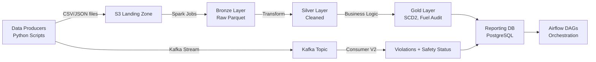
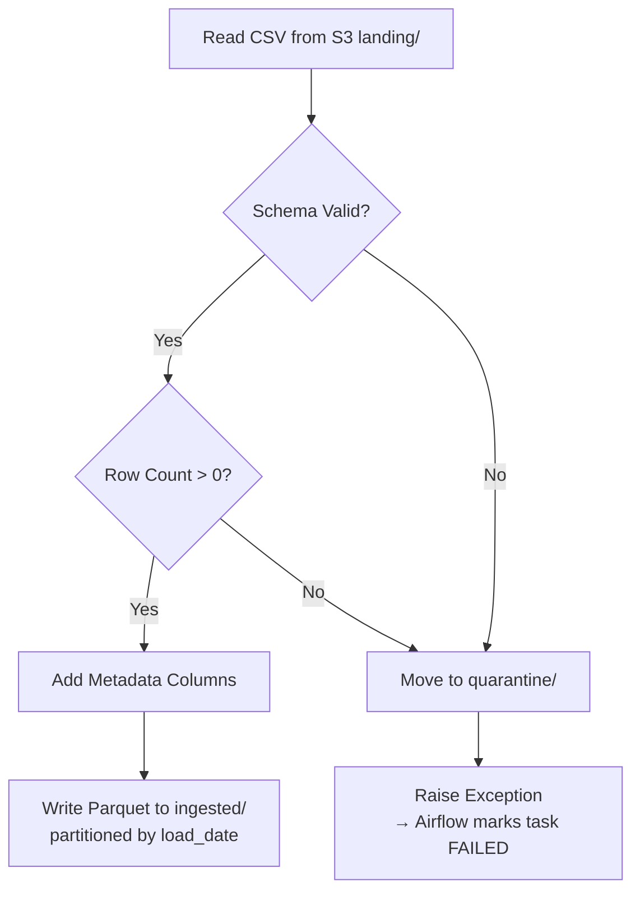
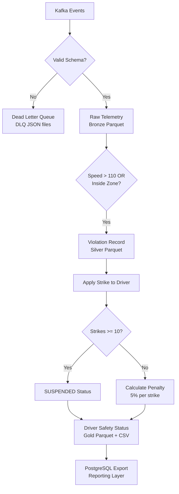

# OmniRoute Codebase Walkthrough — From Scratch

This document walks you through **every file** your partner has written, in the exact order you should read them to understand the full data pipeline.

---

## 🏗️ Big Picture: What Is This Project?

OmniRoute is a **logistics fleet management data pipeline** that:

1. **Generates synthetic data** (fake but realistic) for vehicles, drivers, fuel, maintenance, GPS telemetry
2. **Ingests that data** into a **Medallion Architecture** (Bronze → Silver → Gold) on S3 using Spark
3. **Streams real-time telemetry** via Kafka → detects safety violations → tracks driver strikes
4. **Orchestrates everything** with Apache Airflow DAGs



---

## Step 1: The Central Config — `data/scripts/config.py`

📄 [config.py](file:///home/tushar-katyal/Documents/omniroute-main/data/scripts/config.py)

> [!IMPORTANT]
> **Read this first!** Every other script imports from this file. It's the single source of truth for all paths, constants, and configuration.

### What it does:

| Section | Purpose |
|---------|---------|
| `PROJECT_ROOT`, `DATA_DIR` | Establishes base paths relative to the script location |
| `RAW_DIR`, `PROCESSED_DIR` | Defines where raw CSV/JSON and processed Parquet live |
| File path constants (`VEHICLE_REGISTRY_FILE`, etc.) | Centralizes every file path so no script hardcodes paths |
| `VEHICLE_REGISTRY_CONFIG` | 500 vehicles, 5 truck models, 4 fuel types |
| `VEHICLE_ASSIGNMENT_CONFIG` | 1800 rows, 8 regions, daily rate ₹300–₹1200 |
| `FUEL_CONFIG` | 25,000 transactions, fuel 20–150L, distance 100–500km |
| `MAINTENANCE_CONFIG` | 1000 records, 6 service types |
| `ZONES_CONFIG` | 8 restricted zones around Delhi (lat/long ranges) |
| `TELEMETRY_CONFIG` | Kafka topic, speed thresholds (normal/high/extreme) |
| `POSTGRES_CONFIG` | Reporting DB connection (env vars with defaults) |

### Key Design Decision:
- All config uses **`os.getenv()` with defaults** — works locally without `.env` but can be overridden in production
- `os.makedirs(..., exist_ok=True)` ensures directories exist before any script runs

---

## Step 2: The Data Producers (Data Generation Layer)

These scripts create the **synthetic datasets** that simulate a real logistics company. They run in a **specific order** because some depend on others.

### 2a. Vehicle Registry Producer

📄 [vehicle_registry_producer.py](file:///home/tushar-katyal/Documents/omniroute-main/data/scripts/vehicle_registry_producer.py)

**Purpose:** Generate 500 unique vehicles with VIN, model, manufacturing year, and fuel type.

**Flow:**
```
generate 500 records → add 3 edge cases → write CSV
```

**How it works:**
1. `generate_vin()` — Creates random 8-char alphanumeric VINs, ensures **no duplicates** using a set
2. Each vehicle gets a random model (from 5 Indian/US truck models) and fuel type
3. **Edge cases injected:**
   - A **duplicate VIN** record (tests dedup in downstream pipeline)
   - A record with **empty `mfg_year`** (tests null handling)
   - A record with **`INVALID_FUEL`** fuel type (tests data validation)

**Output:** `data/raw/vehicle_registry.csv` (503 rows = 500 + 3 edge cases)

> [!NOTE]
> This is the **first** producer to run because vehicle assignment, fuel, and maintenance all depend on VINs from this file.

---

### 2b. Vehicle Assignment Producer

📄 [vehicle_assignment_producer.py](file:///home/tushar-katyal/Documents/omniroute-main/data/scripts/vehicle_assignment_producer.py)

**Purpose:** Generate driver-to-vehicle assignment history. This is the data that will become **SCD Type 2** (Slowly Changing Dimension) in the Gold layer.

**Flow:**
```
load VINs from registry → generate 1-4 assignments per VIN → add BRD edge cases → shuffle → write CSV
```

**How it works:**
1. `load_vins()` — Reads VIN column from vehicle_registry.csv (dependency!)
2. For each VIN, creates 1–4 sequential assignments with:
   - Unique `driver_id` (DRV_00001, DRV_00002, ...)
   - `start_timestamp` / `end_timestamp` as **Unix timestamps**
   - The **last assignment** for each VIN has `end_timestamp = ""` → means "still active"
   - Random `daily_rate` (₹300–₹1200) and `region`

3. **Critical BRD Edge Cases:**

| Edge Case | What It Tests |
|-----------|--------------|
| `VIN-SWAP-TEST` with DRV_SWAP_1 → DRV_SWAP_2 | **Driver Swap** — tests SCD2 closing one row and opening another |
| `VIN-CONFLICT-TEST` with DRV_CONF_A + DRV_CONF_B (same start) | **Conflict Resolution** — two drivers assigned same VIN same day |
| `INVALID123` with DRV_BAD | **Invalid VIN** — tests join failure with registry |

4. `random.shuffle(data)` — Deliberately randomizes row order to simulate real-world unordered data

**Output:** `data/raw/vehicle_assignment.csv` (~1800+ rows)

---

### 2c. Fuel Transactions Producer

📄 [fuel_transactions_producer.py](file:///home/tushar-katyal/Documents/omniroute-main/data/scripts/fuel_transactions_producer.py)

**Purpose:** Generate 25,000 fuel refueling records per vehicle, with realistic fuel efficiency calculations.

**Flow:**
```
load VINs + models → generate 25K transactions with realistic efficiency → add BRD edge cases → shuffle → write CSV
```

**How it works:**
1. `load_vins()` — Builds a VIN→model mapping (needs model to look up baseline efficiency)
2. **Baseline fuel efficiency per truck model:**
   ```
   Freightliner M2  → 5.0 km/L
   Volvo VNL        → 4.5 km/L
   Isuzu N-Series   → 6.0 km/L
   Tata Ultra       → 5.5 km/L
   Ashok Leyland    → 8.0 km/L
   ```
3. For each transaction:
   - Random distance (100–500 km), cumulative odometer
   - **5% chance** of anomalous efficiency (85% of baseline) — intentionally bad fuel economy
   - **95% chance** of normal efficiency (95–105% of baseline)
   - `fuel_liters = distance / efficiency`

4. **BRD Edge Cases:**

| Edge Case | What It Tests |
|-----------|--------------|
| `TXN_MAINT_TEST` on `vins[0]` for 2026-05-10 | **Maintenance Exclusion** — fuel anomaly on a day with known maintenance (should be excluded from alerts) |
| `TXN_WEEKEND_TEST` on Sunday 2026-05-17 | **Weekend Exclusion** — anomaly on weekend (business rule: ignore weekend anomalies) |
| `TXN_BAD_EFF_TEST` on Tuesday 2026-05-12 | **True Anomaly** — bad efficiency on a weekday with no maintenance (should trigger alert) |
| 1% duplicate rows | Tests dedup logic |
| 0.5% zero/negative fuel | Tests null/invalid value handling |
| 0.5% decreasing odometer | Tests odometer rollback detection |

**Output:** `data/raw/fuel_transactions.csv` (~25,500 rows)

---

### 2d. Maintenance Schedules Producer

📄 [maintenance_schedules_producer.py](file:///home/tushar-katyal/Documents/omniroute-main/data/scripts/maintenance_schedules_producer.py)

**Purpose:** Generate 1000 maintenance service records across the year.

**Flow:**
```
load VINs → generate 1000 records → add edge cases → shuffle → write CSV
```

**How it works:**
1. Each record: random VIN + random date in 2026 + random service type
2. **Edge Cases:**
   - Forces `vins[0]` to have maintenance on **2026-05-10** (coordinates with fuel producer's `TXN_MAINT_TEST`)
   - 1% duplicates
   - 0.5% with `INVALID_` VINs (tests referential integrity)
   - 0.5% with `INVALID_DATE` strings (tests date parsing)

**Output:** `data/raw/maintenance_schedules.csv` (~1020 rows)

> [!TIP]
> The maintenance date 2026-05-10 on `vins[0]` is **deliberately coordinated** with the fuel producer. This lets the Gold layer's fuel audit pipeline know: "this vehicle was in the shop this day, so its terrible fuel efficiency is expected, not a fraud flag."

---

### 2e. Restricted Zones Producer

📄 [restricted_zones_producer.py](file:///home/tushar-katyal/Documents/omniroute-main/data/scripts/restricted_zones_producer.py)

**Purpose:** Generate 8 geofenced restricted zones around Delhi NCR.

**Flow:**
```
generate 8 zones with lat/long bounding boxes → add edge cases → write JSON
```

**How it works:**
1. Each zone = a rectangular bounding box defined by `min_lat`, `max_lat`, `min_long`, `max_long`
2. Zone names are realistic: "IGI Airport Zone", "Delhi Cantonment", "Military Base Area", etc.
3. **Edge Cases:**

| Edge Case | What It Tests |
|-----------|--------------|
| 2 overlapping zones | Geofence overlap detection |
| Zone with lat 200/300 | Invalid coordinates validation |
| Empty zone `{}` | Missing field handling |
| Zone spanning 1° lat × 2° long | Unreasonably large zone filtering |

**Output:** `data/raw/restricted_zones.json` (13 zones = 8 valid + 5 edge cases)

---

### 2f. Telemetry Producer (Real-Time Kafka Stream)

📄 [telemetry_producer.py](file:///home/tushar-katyal/Documents/omniroute-main/data/scripts/telemetry_producer.py)

**Purpose:** Continuously stream GPS + speed events to Kafka, simulating real-time vehicle tracking.

**Flow:**
```
load VINs + assignments + zones → inject edge cases → infinite loop sending 50 events/second to Kafka
```

**How it works:**
1. **Connects to Kafka** using `KafkaProducer` with JSON serialization
2. **Loads reference data:** VINs, active assignments (VIN→driver mapping), restricted zones
3. **Event generation** with controlled probability distribution:
   - **80%** → Normal speed (40–100 km/h), random location
   - **15%** → High speed (110–130 km/h), 50% chance forced into a restricted zone
   - **5%** → Extreme speed (130–160 km/h), always forced into a restricted zone

4. **Key feature:** `producer.send(KAFKA_TOPIC, key=vin.encode("utf-8"), ...)` — Uses VIN as partition key so all events for the same vehicle go to the same Kafka partition (guarantees ordering per vehicle)

5. **Assignment cache refresh:** Every 60 seconds, re-reads the assignment file to pick up driver swaps

6. **BRD Edge Cases injected before the main loop:**

| Edge Case | What It Tests |
|-----------|--------------|
| `VIN-DOUBLE-VIOLATION` (speed 115 + inside zone) | Double violation = only 1 strike (BRD cap rule) |
| `VIN-SUSPENSION` (11 speeding events) | Suspension → 10 strikes = SUSPENDED status |
| `VIN-LATE` (timestamp 3 days ago) | Late-arriving data handling |
| `1HGBH225` with empty `driver_id` | Anonymous truck — consumer must join with assignment data |
| `DLQ_TEST` with `speed: "WAY TOO FAST"` | Bad JSON → Dead Letter Queue |

> [!WARNING]
> The telemetry producer runs in an **infinite loop** (`while True`). It's designed to be stopped with Ctrl+C, which triggers graceful shutdown (`producer.flush()` + `producer.close()`).

---

### 2g. Run All Producers (Orchestrator)

📄 [run_all_producers.py](file:///home/tushar-katyal/Documents/omniroute-main/data/scripts/run_all_producers.py)

**Purpose:** Single entry point to generate all data in the correct order.

**Execution order:**
```
1. Vehicle Registry  (no dependencies)
2. Vehicle Assignment (depends on registry)
3. Maintenance        (depends on registry)
4. Fuel Transactions  (depends on registry)
5. Restricted Zones   (no dependencies)
6. [Optional] Telemetry stream (depends on all above)
```

- Each script runs as a **subprocess** with error checking
- Prompts user before starting the infinite telemetry stream

---

## Step 3: Spark Ingestion Jobs (Bronze Layer)

These are **PySpark scripts** that read the raw CSV files from an S3 landing zone and write them as **Parquet** to the ingested zone. This is the **Bronze layer** of the Medallion Architecture.

### Common Pattern Across All 4 Jobs:

Every ingestion job follows this exact pattern:



**Metadata columns added to every record:**
- `load_date` — The DAG's execution date (for time-travel queries)
- `ingestion_timestamp` — Exact wall-clock time of ingestion
- `source_file_name` — Traceability back to the CSV
- `batch_id` — UUID to identify this specific batch run

---

### 3a. Vehicle Registry Ingestion

📄 [daily_ingest_vehicle_registry.py](file:///home/tushar-katyal/Documents/omniroute-main/spark_jobs/batch/daily_ingest_vehicle_registry.py)

**Schema enforced:**
```python
vin: String (NOT NULL)
model: String
mfg_year: Integer
fuel_type: String
```

- **Load type:** FULL SNAPSHOT (daily) — Each run appends the complete registry to that day's partition
- **Write mode:** `append` → Partitioned by `load_date`
- **On failure:** Raw CSV is dumped to `quarantine/dt=YYYY-MM-DD/`

---

### 3b. Vehicle Assignment Ingestion

📄 [daily_ingest_vehicle_assignment.py](file:///home/tushar-katyal/Documents/omniroute-main/spark_jobs/batch/daily_ingest_vehicle_assignment.py)

**Schema enforced:**
```python
vin: String (NOT NULL)
driver_id: String (NOT NULL)
start_timestamp: Long
end_timestamp: Long
daily_rate: Float
region: String
```

- **Load type:** INCREMENTAL (daily) — Only new/changed assignments since last run
- Same quarantine pattern on failure

---

### 3c. Fuel Transactions Ingestion

📄 [daily_ingest_fuel_transactions.py](file:///home/tushar-katyal/Documents/omniroute-main/spark_jobs/batch/daily_ingest_fuel_transactions.py)

**Schema enforced:**
```python
transaction_id: String (NOT NULL)
vin: String (NOT NULL)
fuel_liters: Float
odometer_reading: Float
timestamp: String
```

- **Load type:** INCREMENTAL (daily)
- Same pattern

---

### 3d. Maintenance Schedules Ingestion

📄 [yearly_ingest_maintenance_schedules.py](file:///home/tushar-katyal/Documents/omniroute-main/spark_jobs/batch/yearly_ingest_maintenance_schedules.py)

**Schema enforced:**
```python
vin: String (NOT NULL)
service_date: String
service_type: String
```

- **Load type:** YEARLY (runs once on Jan 1st)
- Same pattern

> [!NOTE]
> All S3 paths (`LANDING_PATH`, `INGESTED_PATH`, `QUARANTINE_PATH`) are loaded from **environment variables** with sensible defaults. This means the same code works locally (using local filesystem) and in production (using S3).

---

## Step 4: Kafka Consumers (Streaming Pipeline)

Three consumers exist, representing the evolution of the streaming approach:

### 4a. Basic Consumer (V1)

📄 [telemetry_consumer.py](file:///home/tushar-katyal/Documents/omniroute-main/data/scripts/consumer_scripts/telemetry_consumer.py)

**Purpose:** Simple Kafka → Parquet writer. No business logic.

**How it works:**
1. Connects to Kafka with **manual offset commit** (not auto-commit)
2. Accumulates 500 events into a batch
3. Deduplicates by `(vin, event_timestamp)`
4. Writes to date-partitioned Parquet: `telemetry/year=YYYY/month=MM/day=DD/`
5. **Only commits offset AFTER successful write** — guarantees at-least-once delivery

> [!TIP]
> The `enable_auto_commit=False` + commit-after-write pattern is a key reliability feature. If the consumer crashes mid-batch, Kafka will re-deliver those messages on restart.

---

### 4b. Spark Structured Streaming Consumer

📄 [spark_streaming_consumer.py](file:///home/tushar-katyal/Documents/omniroute-main/data/scripts/consumer_scripts/spark_streaming_consumer.py)

**Purpose:** A Spark Structured Streaming alternative — reads from Kafka and prints to console.

**How it works:**
1. Creates SparkSession with Kafka connector package
2. Reads stream from Kafka topic, parses JSON using defined schema
3. Prints parsed events to console every 5 seconds

> This is more of a **debugging/development tool** — not the production consumer.

---

### 4c. Telemetry Consumer V2 (Production Pipeline) ⭐

📄 [telemetry_consumer_v2.py](file:///home/tushar-katyal/Documents/omniroute-main/data/scripts/consumer_scripts/telemetry_consumer_v2.py)

**Purpose:** This is the **full production streaming pipeline**. It implements the complete BRD safety logic.

> [!IMPORTANT]
> This is the most complex file in the project. It implements 7 features in a single consumer.

**Architecture breakdown (7 stages):**



#### Stage 1: Reference Data Loading (Lines 102–176)
- Loads **restricted zones** with validation (rejects invalid coordinates, zones > 0.5° span)
- Loads **active assignments** with **caching** — only re-reads file if modified (`mtime` check)
- For conflict resolution: if two drivers are assigned the same VIN, keeps the one with the **higher daily_rate**

#### Stage 2: State Management (Lines 182–254)
- Strike state is **persisted to disk** as JSON (`strike_state.json`) for crash recovery
- **Monthly cooldown logic** (BRD Section 3.3):
  - On the 1st of the month at 05:00 UTC, reset all strike counts to 0
  - **Exception:** SUSPENDED drivers are NOT reset — they stay suspended

#### Stage 3: Violation Detection (Lines 261–293)
- **Speed violation:** `speed > 110 km/h`
- **Zone intrusion:** `(lat, long)` falls within any restricted zone's bounding box
- **BRD Cap Rule:** Even if BOTH violations happen on the same event → **only 1 strike** added

#### Stage 4: Strike & Penalty Calculation (Lines 296–323)
- Each violation adds +1 strike (capped at 10)
- 10 strikes → `SUSPENDED` status
- Penalty: `adjusted_rate = base_rate - (base_rate × 0.05 × strike_count)`
  - Example: ₹1000 base rate, 3 strikes → ₹1000 - (₹1000 × 0.05 × 3) = ₹850

#### Stage 5: PostgreSQL Export (Lines 330–370)
- Upserts driver safety records into `gold.driver_safety_status` table
- Uses `ON CONFLICT (driver_id) DO UPDATE` for idempotency
- **Non-blocking:** If Postgres is down, logs a debug message and continues (doesn't crash pipeline)

#### Stage 6: Parquet Writers (Lines 377–446)
- **Atomic writes:** Write to `.tmp` file first, then `os.replace()` — prevents half-written files
- **Three outputs:**
  - Raw telemetry → Bronze (`telemetry/year=X/month=X/day=X/`)
  - Violations → Silver (`violations/year=X/month=X/day=X/`)
  - Driver safety status → Gold (`driver_safety_status/`)

#### Stage 7: Main Consumer Loop (Lines 453–556)
- **Batch processing:** Accumulates up to 500 events OR flushes every 60 seconds
- **Processing per event:**
  1. Validate → DLQ if invalid
  2. Enrich with driver_id from assignment lookup
  3. Detect violations
  4. Apply strikes if driver is known
- **Flush cycle:**
  1. Check monthly cooldown
  2. Refresh assignment cache
  3. Write DLQ, raw telemetry, violations, safety status
  4. Save strike state to disk
  5. **Then** commit Kafka offsets ← idempotency guarantee

---

## Step 5: Airflow DAGs (Orchestration Layer)

Three DAGs orchestrate the entire batch pipeline:

### 5a. Daily Batch DAG

📄 [omniroute_daily_batch.py](file:///home/tushar-katyal/Documents/omniroute-main/dags/omniroute_daily_batch.py)

**Schedule:** `0 5 * * *` (Daily at 05:00 UTC)

**Currently Active Tasks (Bronze):**
```
ingest_vehicle_registry  ─┐
ingest_vehicle_assignment ─┼─ (run in parallel)
ingest_fuel_transactions ─┘
```

**Planned but commented out:**
```
Bronze → Silver:
  [registry + assignment] >> transform_assignment
  [registry + fuel]       >> transform_fuel

Silver → Gold:
  transform_assignment >> build_scd2 (SCD Type 2)
  build_scd2 >> build_fuel_audit
  transform_fuel >> build_fuel_audit
  build_scd2 >> build_fleet_snapshot

Gold → Reporting:
  [fuel_audit + fleet_snapshot] >> load_postgres >> generate_reports
```

**Key configuration:**
- `max_active_runs=1` — Only one instance of this DAG runs at a time
- `catchup=False` — Don't backfill historical runs
- `retries=2` with 5-min delay — Auto-retry failed tasks
- `{{ ds }}` — Airflow template for execution date (YYYY-MM-DD)

> [!NOTE]
> The `spark_cmd()` helper builds spark-submit commands pointing to `/opt/omniroute/spark_jobs/`. This matches the deployment instructions in the README: `sudo cp -r spark_jobs/* /opt/omniroute/spark_jobs/`.

---

### 5b. Monthly Cooldown DAG

📄 [omniroute_monthly_batch.py](file:///home/tushar-katyal/Documents/omniroute-main/dags/omniroute_monthly_batch.py)

**Schedule:** `0 5 1 * *` (1st of every month at 05:00 UTC)

**Planned tasks (currently commented out):**
```
reset_driver_strikes >> generate_rate_deduction_report
```

**Purpose:**
- Reset strike counts for eligible (non-suspended) drivers
- Generate a monthly report showing which drivers had rate deductions

---

### 5c. Yearly Maintenance DAG

📄 [omniroute_yearly_batch.py](file:///home/tushar-katyal/Documents/omniroute-main/dags/omniroute_yearly_batch.py)

**Schedule:** `0 0 1 1 *` (January 1st at midnight UTC)

**Active task:**
```
bronze:
  └── ingest_maintenance_schedules
```

**Planned (commented out):**
```
bronze >> silver (clean_maintenance_logs)
```

**Purpose:** Ingest the full year's maintenance schedule at the start of each year.

---

## Summary: What's Done vs. What's Left

| Component | Status | Notes |
|-----------|--------|-------|
| Data Producers (6 scripts) | ✅ Complete | All CSV/JSON + edge cases |
| Run All Producers orchestrator | ✅ Complete | Sequential execution |
| Bronze Ingestion (4 Spark jobs) | ✅ Complete | Schema validation + quarantine |
| Telemetry Consumer V1 | ✅ Complete | Basic Kafka → Parquet |
| Telemetry Consumer V2 | ✅ Complete | Full safety pipeline |
| Spark Streaming Consumer | ✅ Complete | Debug/dev tool |
| Daily DAG (Bronze) | ✅ Active | 3 ingestion tasks running |
| Daily DAG (Silver/Gold/Reporting) | ⏳ Commented out | Spark jobs not yet written |
| Monthly DAG | ⏳ Commented out | Logic exists in Consumer V2 |
| Yearly DAG (Bronze) | ✅ Active | 1 ingestion task running |
| Yearly DAG (Silver) | ⏳ Commented out | Spark job not yet written |

> [!IMPORTANT]
> **Your partner has completed:** The data generation layer, the Bronze ingestion layer, and the full streaming pipeline (Consumer V2). What remains is building the Silver/Gold Spark batch transformation jobs and un-commenting the DAG tasks.
