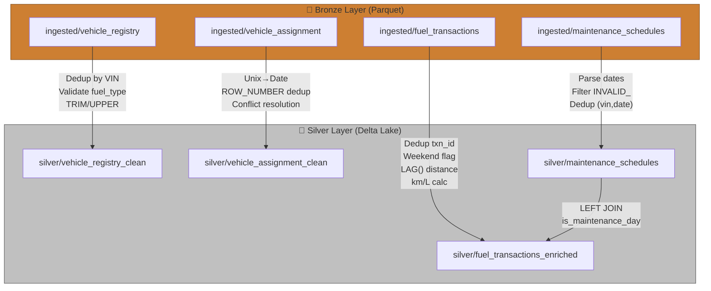
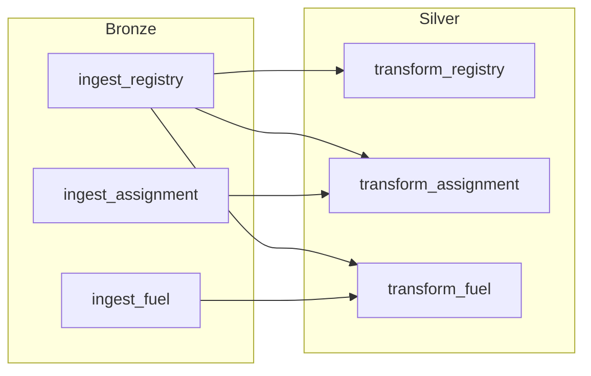

# Silver Layer — Walkthrough

## What Was Built

4 new PySpark transformation scripts + 2 updated Airflow DAGs that take Bronze layer **Parquet** data and write cleansed, enriched **Delta Lake** tables to the Silver layer.

---

## Files Created & Modified

### New Scripts (4)

| # | File | Purpose |
|---|------|---------|
| 1 | [transform_vehicle_registry.py](file:///home/tushar-katyal/Documents/omniroute-main/spark_jobs/batch/transform_vehicle_registry.py) | Dedup by VIN, validate fuel_type & mfg_year, TRIM/UPPER |
| 2 | [transform_vehicle_assignment.py](file:///home/tushar-katyal/Documents/omniroute-main/spark_jobs/batch/transform_vehicle_assignment.py) | Unix→Date, ROW_NUMBER dedup (highest daily_rate), conflict resolution |
| 3 | [transform_maintenance_schedules.py](file:///home/tushar-katyal/Documents/omniroute-main/spark_jobs/batch/transform_maintenance_schedules.py) | Parse dates, filter INVALID_ VINs, dedup by (vin, service_date) |
| 4 | [transform_fuel_transactions.py](file:///home/tushar-katyal/Documents/omniroute-main/spark_jobs/batch/transform_fuel_transactions.py) | Most complex: dedup, weekend flag, maintenance JOIN, LAG() for distance, km/L |

### Updated DAGs (2)

| # | File | Changes |
|---|------|---------|
| 5 | [omniroute_daily_batch.py](file:///home/tushar-katyal/Documents/omniroute-main/dags/omniroute_daily_batch.py) | Added Silver TaskGroup with 3 transform tasks, `spark_delta_cmd()` helper, Bronze→Silver dependencies |
| 6 | [omniroute_yearly_batch.py](file:///home/tushar-katyal/Documents/omniroute-main/dags/omniroute_yearly_batch.py) | Added Silver TaskGroup with maintenance transform, Bronze→Silver dependency |

---

## Architecture: Bronze → Silver Data Flow



---

## Edge Cases Handled Per Script

### 1. Vehicle Registry

| Edge Case (from producer) | How Silver Handles It |
|---------------------------|----------------------|
| Duplicate VIN rows | `ROW_NUMBER() PARTITION BY vin ORDER BY load_date DESC` → keep latest |
| Empty `mfg_year` | Cast to Integer → NULL → filtered by `mfg_year IS NOT NULL` |
| `fuel_type = "INVALID_FUEL"` | Filtered by `fuel_type IN (DIESEL, LNG, CNG, ELECTRIC)` |

### 2. Vehicle Assignment

| Edge Case (from producer) | How Silver Handles It |
|---------------------------|----------------------|
| Driver Swap (VIN-SWAP-TEST) | Both records pass through (different start_dates), feeds Gold SCD2 |
| Pay Rate Conflict (VIN-CONFLICT-TEST) | `ROW_NUMBER() PARTITION BY (vin, start_date) ORDER BY daily_rate DESC` → $600 wins |
| Ghost Truck (INVALID123) | Passes Silver (vin not null), fails Gold JOIN with registry |
| Empty end_timestamp | Converted to `end_date = NULL` → means "currently active" |

### 3. Maintenance Schedules

| Edge Case (from producer) | How Silver Handles It |
|---------------------------|----------------------|
| `service_date = "INVALID_DATE"` | `to_date()` returns NULL → filtered out |
| `vin = "INVALID_1234"` | Filtered by `NOT vin.startswith("INVALID_")` |
| Duplicate rows (~1%) | `ROW_NUMBER() PARTITION BY (vin, service_date)` → keep first |
| Target Day (May 10, 2026) | Preserved — consumed by fuel tx JOIN |

### 4. Fuel Transactions

| Edge Case (from producer) | How Silver Handles It |
|---------------------------|----------------------|
| `TXN_MAINT_TEST` (May 10) | LEFT JOIN with maintenance → `is_maintenance_day = TRUE` |
| `TXN_WEEKEND_TEST` (Sunday May 17) | `dayofweek() = 1` → `is_weekend = TRUE` |
| `TXN_BAD_EFF_TEST` (Tuesday May 12) | `is_weekend = FALSE`, `is_maintenance_day = FALSE` → **passes through to Gold for flagging** |
| Duplicate transaction rows (~1%) | `ROW_NUMBER() PARTITION BY transaction_id` → keep first |
| `fuel_liters = 0 or -10` | Filtered by `fuel_liters > 0` |
| Reversing odometer | `distance_km ≤ 0` → `km_per_liter = NULL` → excluded from Gold audit |

---

## DAG Dependency Wiring

### Daily DAG (`omniroute_daily_batch`)



### Yearly DAG (`omniroute_yearly_maintenance`)


---

## Validation Results

All files pass Python syntax validation:
```
✅ dags/omniroute_daily_batch.py — Syntax OK
✅ dags/omniroute_yearly_batch.py — Syntax OK
✅ dags/omniroute_monthly_batch.py — Syntax OK
✅ spark_jobs/batch/transform_vehicle_registry.py — Syntax OK
✅ spark_jobs/batch/transform_vehicle_assignment.py — Syntax OK
✅ spark_jobs/batch/transform_maintenance_schedules.py — Syntax OK
✅ spark_jobs/batch/transform_fuel_transactions.py — Syntax OK
```
